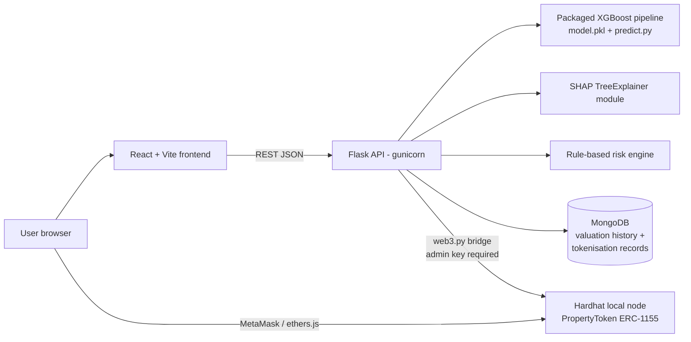

# AI-Powered Real Estate Asset Valuation and Risk-Aware Tokenisation

A capstone system that estimates residential property prices with a
tuned gradient-boosting model, explains every estimate with SHAP,
scores listing risk with a documented rule-based engine, and represents
the valuation as fractional ERC-1155 tokens on a local Ethereum network
at a fixed ₹10,000 denomination.

**Honesty notes (read first):** the model's grouped held-out test
R² is 0.7423 — R² 0.95+ was investigated and is *not* attainable with
this dataset (see `optimization_stage/`). The tokens are an academic
prototype on a local test network; they do **not** represent legal
ownership of any property. The risk score is a transparent prototype
methodology, not validated investment advice.

## Architecture



More diagrams: `architecture/architecture_diagram.md`.

## Repository layout

| Path | Contents |
|---|---|
| `backend/` | Flask API, packaged ML model + SHAP (`backend/ml/`), risk engine, chain bridge, tests |
| `frontend/` | React 19 + Vite + TypeScript application (8 pages) |
| `blockchain/` | Hardhat project: `PropertyToken.sol` (ERC-1155), tests, deploy/demo scripts, ABI, `INTEGRATION.md` |
| `architecture/`, `eda_stage/`, `preprocessing_stage/`, `training_stage/`, `optimization_stage/` | The staged engineering record (design, EDA, features, training, 74-experiment optimisation) |
| `INTEGRATION_REPORT.md`, `AUDIT_REPORT.md`, `DEPLOYMENT_TESTING.md` | Integration, QA audit and deployment-verification reports |
| `render.yaml`, `.gitignore` | Deployment blueprint and ignore rules |

## Quick start — full local demo (the viva configuration)

Prerequisites: Python 3.12, Node 20+.

```bash
# 1. Backend (terminal 1)
cd backend
python -m venv .venv && source .venv/bin/activate   # or reuse an existing env
pip install -r requirements.txt
cp .env.example .env        # defaults work for local demo
python app.py               # API on http://127.0.0.1:5000 (in-memory history unless MONGO_URI is set)

# 2. Blockchain node + contract (terminal 2)
cd blockchain
npm install
npx hardhat node                                # chain on http://127.0.0.1:8545
npx hardhat run scripts/deploy.js --network localhost   # (terminal 3)

# 3. Frontend (terminal 4)
cd frontend
npm install
npm run dev                 # app on http://127.0.0.1:5173
```

Open the app, value a property, view its SHAP explanation and risk
score, register it on-chain from the Tokenisation page, mint, then buy
and transfer tokens from the Blockchain Explorer with MetaMask pointed
at the local node (chain id 31337).

## Tests

```bash
cd backend && python -m pytest tests/test_api.py -q     # 28 API tests
python test_predict.py && python test_explain.py        # model + SHAP suites
cd ../blockchain && npx hardhat test                    # 16 contract tests
cd ../frontend && npm run build                         # type-check + production build
```

## Deployment

Hosted showcase (Vercel + Render + MongoDB Atlas) and the public
testnet path are documented step-by-step in **DEPLOYMENT.md**. The API
contract is in **API.md**. Nothing in this repository contains real
credentials; every secret is an environment variable (see the
`.env.example` files).

## Key measured results (all reproducible from the stage artifacts)

| Metric | Value | Source |
|---|---|---|
| Served model | XGBoost (Optuna-tuned, exp. E01) | `optimization_stage/` |
| Grouped test R² / MAE / RMSE | 0.7423 / ₹21.46L / ₹74.38L | reproduced in `AUDIT_REPORT.md` |
| Geographic generalisation R² | 0.42–0.61 (protocol-dependent) | training stage + audit |
| Token rule | supply = floor(valuation ₹ / 10,000), residual untokenised | contract + backend, cross-verified |
# ML-PROJECT
