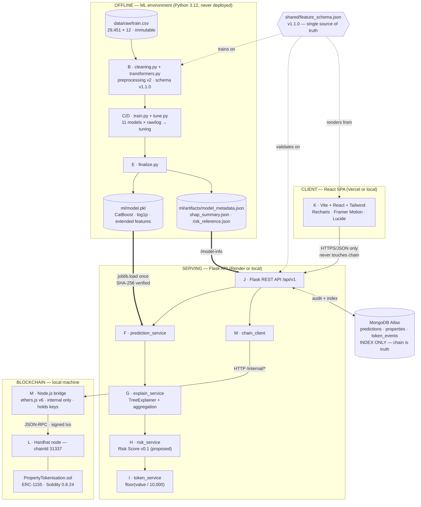
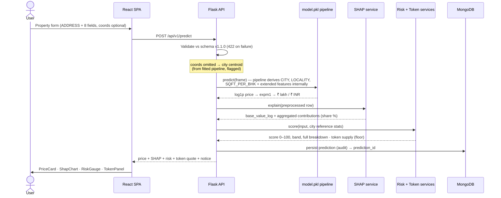
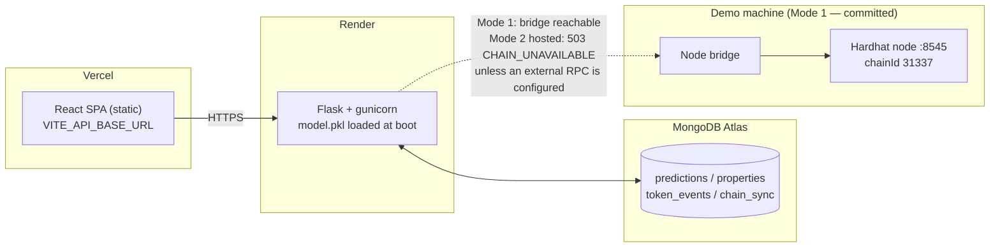
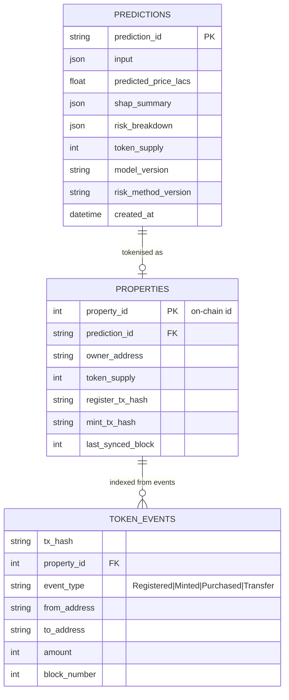

# Architecture Diagrams

**Status:** FOR APPROVAL (companion to `architecture.md`). All diagrams are Mermaid — they render in GitHub, VS Code and the project docs, and are version-controlled as text so any change is reviewable in a diff.

## 1. System architecture (containers & artefacts)



## 2. Sequence — one valuation (the demo path)



## 3. Sequence — tokenisation (register → mint → buy → transfer)

```mermaid
sequenceDiagram
    actor User
    participant UI as React SPA
    participant API as Flask API
    participant DB as MongoDB
    participant BR as Node bridge
    participant SC as PropertyTokenisation (ERC-1155)
    User->>UI: Tokenise (owner address; HIGH-risk ack if required)
    UI->>API: POST /api/v1/tokenise {prediction_id, owner_address}
    API->>DB: re-read stored prediction (price/supply/risk — server-side)
    API->>BR: POST /internal/register (idempotent on prediction_id)
    BR->>SC: registerProperty(owner, valueInr, riskScore, band, supply, metadataHash)
    SC-->>BR: PropertyRegistered(propertyId) + tx hash
    BR-->>API: property_id, register_tx_hash
    API->>BR: POST /internal/mint {property_id}
    BR->>SC: mintTokens(propertyId)
    SC-->>BR: TokensMinted + tx hash
    API->>DB: mirror property + events (index)
    API-->>UI: 201 — property_id, both tx hashes, network: hardhat-local 31337
    Note over User,SC: Later: buyTokens (payable, demo price) and<br/>safeTransferFrom via /tokenise/buy and /tokenise/transfer —<br/>same API → bridge → contract path; ownership always read from chain.
```

## 4. Deployment topology (with the chain constraint)



## 5. Data model — MongoDB index (chain remains the ownership truth)


