# Exploratory Data Analysis Report

**Dataset:** Indian House Price Prediction Challenge — Kaggle (anmolkumar/house-price-prediction-challenge)
**File audited:** `train.csv` · SHA-256 `b960388685fd0ce4e1935f4854fdf2256b556b7976b134d82aa4972525faa32b`
**Dimensions (verified from the file):** 29,451 rows × 12 columns. **Target:** `TARGET(PRICE_IN_LACS)` — continuous price in ₹ lakh, so the modelling task is **regression**.
**Generated by:** `ml/eda.py` + `ml/data_audit.py` from the actual CSV. No model was trained and no row was removed in this stage.
Companion: `data_quality_report.md` (defects, exclusions, verdict).

## 1. Structure and sample

| Column | Type | Role |
|---|---|---|
| POSTED_BY | object | feature |
| UNDER_CONSTRUCTION | int64 | feature |
| RERA | int64 | feature |
| BHK_NO. | int64 | feature |
| BHK_OR_RK | object | feature |
| SQUARE_FT | float64 | feature |
| READY_TO_MOVE | int64 | feature |
| RESALE | int64 | feature |
| ADDRESS | object | feature |
| LONGITUDE | float64 | feature |
| LATITUDE | float64 | feature |
| TARGET(PRICE_IN_LACS) | float64 | **TARGET** |

Input features: 11 (POSTED_BY, UNDER_CONSTRUCTION, RERA, BHK_NO., BHK_OR_RK, SQUARE_FT, READY_TO_MOVE, RESALE, ADDRESS, LONGITUDE, LATITUDE). There is **no identifier column and no bathroom/age/furnishing column** — several real price drivers are simply absent, which caps achievable accuracy.

## 2. Missing values

**0 true nulls in the entire file** (see fig08). Hidden text markers were scanned separately (per-column counts in `data_audit.json`). The dataset's problems are *wrong values*, not missing ones.

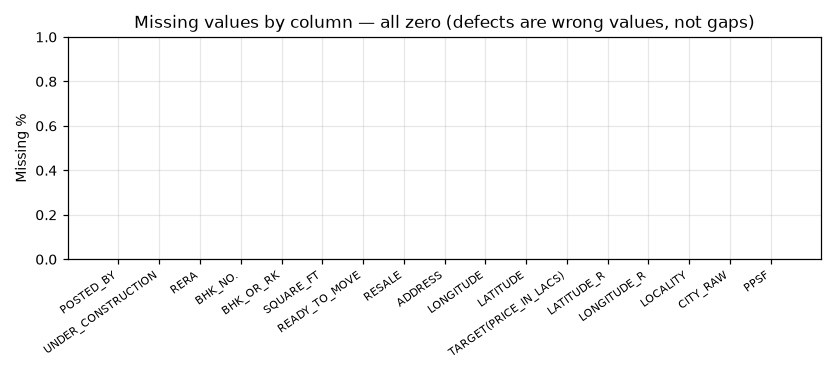

## 3. Target distribution

- Range ₹0.25 – ₹30,000 lakh; mean ₹142.9 lakh vs median ₹62 lakh — the mean is pulled far above the typical property.
- **Skewness 17.58** (extreme right skew); on a log1p scale skew falls to 1.21 — the single strongest argument for a log-target modelling track.
- IQR ₹38–₹100 lakh; 3,084 rows sit above the IQR fence — they are a *population* (the expensive tail), not a handful of typos, and are analysed, not deleted (§7 of the quality report).
- 298 rows exceed ₹1,000 lakh (₹10 crore).

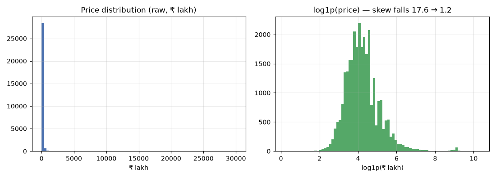
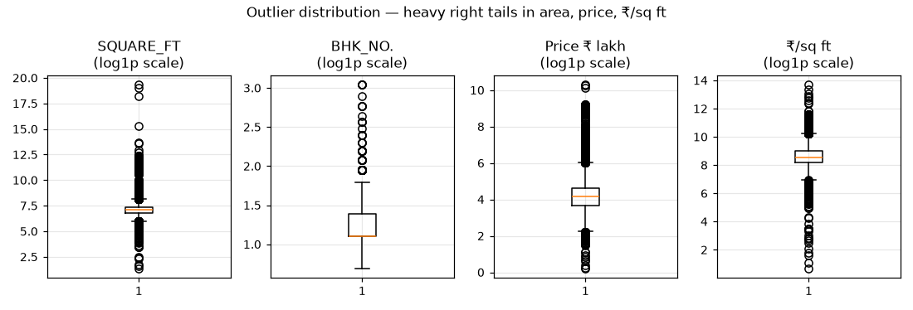

## 4. Numerical features

- SQUARE_FT: median 1,175, max 254,545,454 (a physical impossibility — a field error population: 154 rows > 20,000 sq ft, 0 rows ≤ 0).
- BHK_NO.: 1–20; 14 rows above 10 BHK (rare large homes — weak model support, not errors by themselves).
- Binary flags (UNDER_CONSTRUCTION, RERA, RESALE, READY_TO_MOVE) are true 0/1 with no stray values.

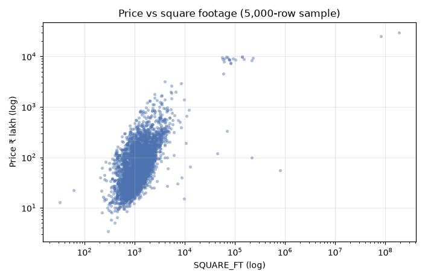
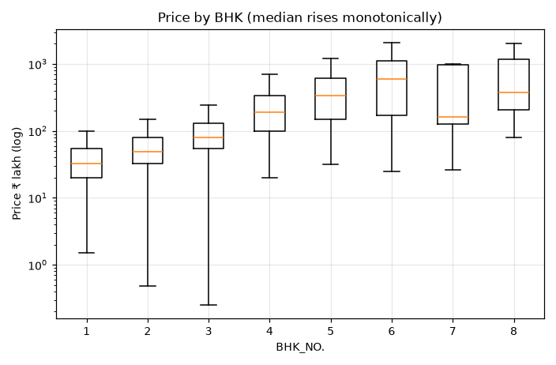

Median price by BHK rises monotonically: 1 BHK ₹33L, 2 BHK ₹50L, 3 BHK ₹80L, 4 BHK ₹190L, 5 BHK ₹340L, 6 BHK ₹600L.

## 5. Categorical features

- **POSTED_BY**: 3 unique values; dominant `Dealer` at 62.11%.
- **BHK_OR_RK**: 2 unique values; dominant `BHK` at 99.92%. **Quasi-constant** — expect near-zero signal.
- **ADDRESS**: 6899 unique values; dominant `Zirakpur,Chandigarh` at 1.73%.
- **UNDER_CONSTRUCTION**: 2 unique values; dominant `0` at 82.02%.
- **RERA**: 2 unique values; dominant `0` at 68.21%.
- **RESALE**: 2 unique values; dominant `1` at 92.96%. **Quasi-constant** — expect near-zero signal.
- **READY_TO_MOVE**: 2 unique values; dominant `1` at 82.02%.

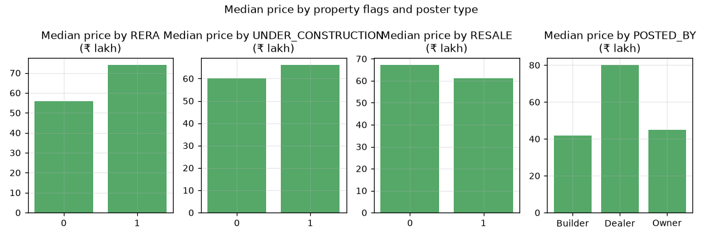

## 6. Location inside ADDRESS

- Format is `Locality,...,City`: 6,899 unique addresses, 5,878 localities, but **256 distinct last-segment labels** mixing cities with states (Goa, Maharashtra). Raw labels cannot be used as a city feature without repair.
- Most frequent address: "Zirakpur,Chandigarh" (509 rows). 597 localities appear under more than one city label (inconsistent naming).
- Top raw city labels (rows): Bangalore 4,340, Lalitpur 2,993, Mumbai 2,023, Pune 1,991, Noida 1,767, Kolkata 1,709, Maharashtra 1,579, Chennai 1,255, Ghaziabad 1,087, Jaipur 962.
- Median price by top city (₹ lakh): Bangalore ₹78, Lalitpur ₹110, Mumbai ₹120, Pune ₹67, Noida ₹70, Kolkata ₹47, Maharashtra ₹130, Chennai ₹50, Ghaziabad ₹44, Jaipur ₹36.

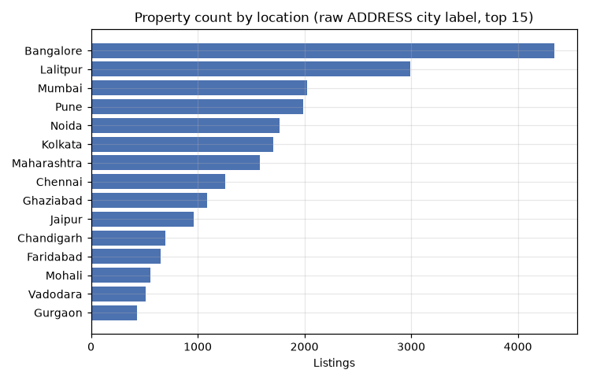
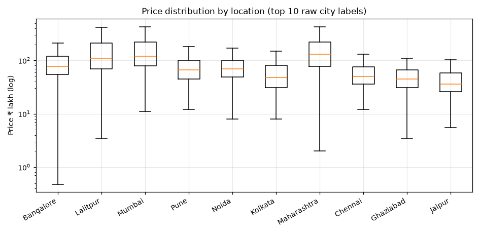

## 7. Geography — the swapped-coordinate defect

- As labelled, **0 rows** are India-plausible; after swapping the two columns, **29,193** are — the columns are verifiably swapped. 258 rows are corrupt under both readings.
- Coordinates are **locality-level, not property-level**: only 4,116 unique pairs for 29,451 rows; the busiest pair covers 1,009 rows. Treat lat/lon as locality features.

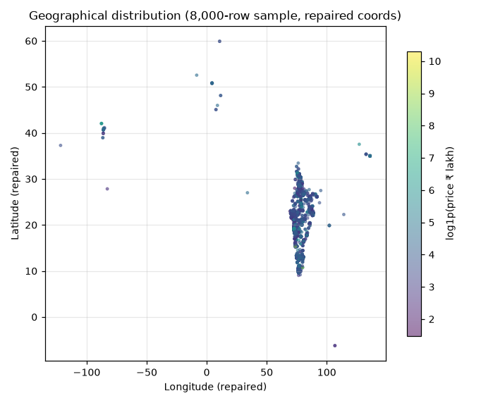

## 8. Relationships with price (linear + nonlinear)

| Feature | Pearson r | Spearman ρ | Reading |
|---|---|---|---|
| SQUARE_FT | 0.403 | 0.570 | strongest raw signal; log scale linearises it |
| LOG_SQFT | 0.597 | 0.570 | log(area) — best linear-form relationship |
| BHK_NO. | 0.112 | 0.501 | strong, monotone (see §4 medians) |
| RERA | 0.068 | 0.151 | weak positive |
| RESALE | -0.207 | -0.037 | Pearson ≪ Spearman gap = outlier-driven mean artefact |
| UNDER_CONSTRUCTION | 0.055 | 0.043 | near zero overall |
| READY_TO_MOVE | -0.055 | -0.043 | mirror of UNDER_CONSTRUCTION (exact complement) |
| LATITUDE_REPAIRED | -0.031 | -0.154 | weak negative (north–south price gradient) |
| LONGITUDE_REPAIRED | -0.017 | -0.171 | weak negative |
| PRICE_PER_SQFT_INR | 0.160 | 0.816 | TARGET-DERIVED — exploration only, never a feature |

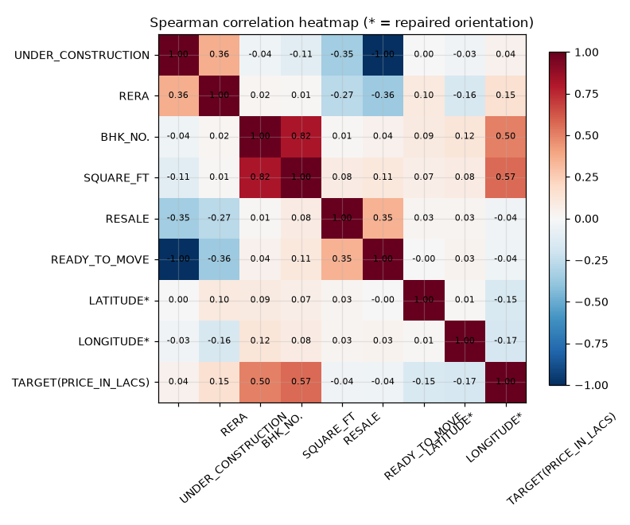
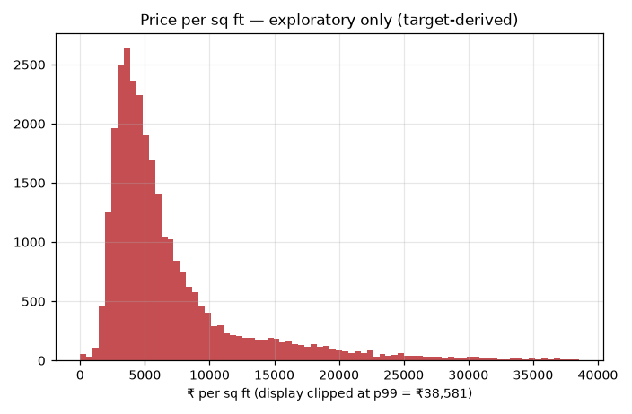

Exploratory price-per-sq-ft (₹): median 5,095, p99 in fig06. It is computed from the target, so it is a diagnostic lens (spotting implausible listings), never an input.

## 9. Duplicates and label noise

- Exact duplicate rows: **401 extra rows** (374 groups); ~137 duplicate pairs would straddle a naive random 80/20 split — de-duplication must precede splitting.
- Duplicate property listings (same ADDRESS + SQUARE_FT + BHK): 622 groups / 1,362 rows.
- **108 feature-identical groups carry different prices** — irreducible label noise that caps any model's achievable R² on this data.

## 10. Leakage and inconsistency findings

- No target-derived column exists in the raw file; no predictor reaches |Spearman| ≥ 0.9 against the target. Direct leakage: none.
- Group leakage is the real risk (duplicates, repeated addresses, shared locality coordinates across a random split) — mitigate by de-duplicating first and also reporting a locality-grouped split.
- READY_TO_MOVE is the exact complement of UNDER_CONSTRUCTION (redundant pair — drop one).
- Inconsistent descriptions: 24 RK rows (0 with BHK_NO. > 1); 43 rows under 100 sq ft per BHK and 171 above 5,000 — area/BHK field errors concentrated in the tails.

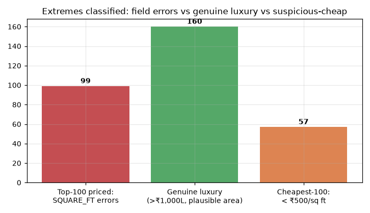

## 11. Suitability verdict

**Suitable for training a residential valuation model, after the documented repairs — with accuracy expectations set by the data, not by ambition.** Strengths: 29k rows, strong monotone area/BHK signal, rich location text, zero missing values. Hard limits: conflicting duplicate prices, absent bathrooms/age/furnishing, locality-level coordinates and a corrupted extreme tail mean a flawless model still faces an error floor on this dataset.

Cleaning applied downstream (`ml/data_cleaning.py`): exact duplicates → coordinate repair/drop → SQUARE_FT plausibility → drop READY_TO_MOVE. The target is never clipped. Full defect register and justifications: `data_quality_report.md`.

## 12. Figures generated (12)

- `figures/fig01_price_distribution.png`
- `figures/fig02_price_vs_sqft.png`
- `figures/fig03_price_vs_bhk.png`
- `figures/fig04_count_by_location.png`
- `figures/fig05_price_by_location.png`
- `figures/fig06_price_per_sqft.png`
- `figures/fig07_correlation_heatmap.png`
- `figures/fig08_missing_values.png`
- `figures/fig09_outlier_distribution.png`
- `figures/fig10_geographical_distribution.png`
- `figures/fig11_price_by_flags.png`
- `figures/fig12_extremes_classification.png`
